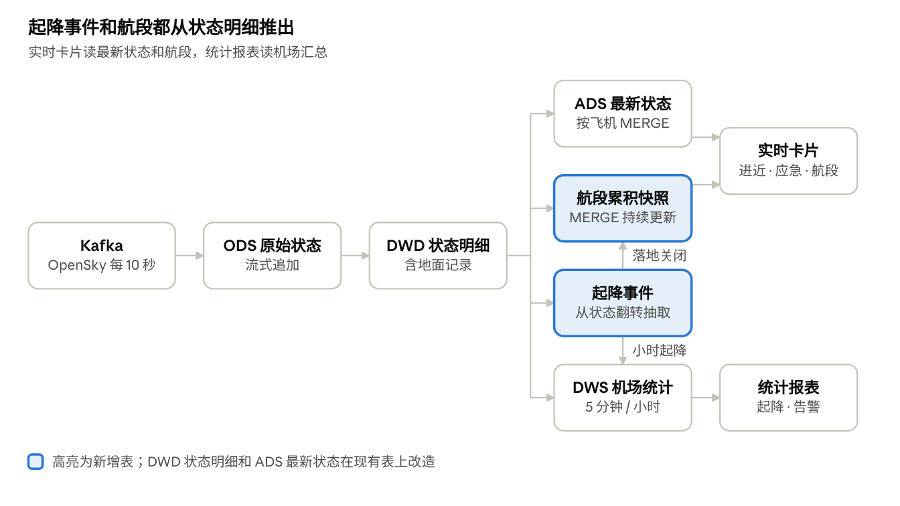

# 航班湖仓 · 机场运行监控需求与口径

2026-10-16 · Peijun Ji

## 背景与目标

航班湖仓服务一个模拟使用方：苏黎世机场（ZRH）运行控制中心的值班员，让他在 30 秒内看到机场周边的进近、起降和应急情况。数据来自 OpenSky 的 ADS-B 状态数据，覆盖北纬 43–52°、东经 2.5–12.5°（90 平方度），演示时每 10 秒一轮。

本文档是下游设计的唯一依据。SLA、告警阈值、质量规则、表结构和指标口径都从这里推出；改口径先改本文档，再改代码。

目标分两组，每条都可测量，实测值写进 README：

**使用方目标**

- 当前进近架数和航段状态：端到端新鲜度 P95 ≤ 30 秒
- 应急代码：从快照到推送 ≤ 1 分钟，同一航段只推一次
- 小时起降统计：新鲜度 ≤ 20 分钟；落地事件抽查准确率达到校准后的目标

**工程目标**

- 处理延迟：从写入 Kafka 到服务层可查，P95 ≤ 10 秒
- 不丢不重：流作业被强制终止后从 checkpoint 恢复，ODS 按 (partition, offset) 对账零重复、零断号；批任务重跑两次结果校验和一致
- 可发现：采集中断、流作业停止、延迟超标、质量检查失败，都在 1 分钟内告警
- 可重算：任一历史日期可单独回刷，其他日期不受影响
- 口径唯一：每个指标只在本文档定义一次，看板和代码引用同一份
- 有余量：90 平方度范围、10 秒轮询下连续运行，每批处理耗时稳定小于 5 秒的触发间隔

## 使用方与使用场景

主使用方是运行值班员，看数据做决策；第二使用方是数据值班，保证数据按时、正确地到达。

| 使用方 | 角色 | 用数据做什么决策 | 看什么 | 频率 |
| --- | --- | --- | --- | --- |
| 运行值班员（主） | ZRH 运行控制中心，三班倒 | 进港高峰前调配地勤和机位；应急情况第一时间上报 | Grafana 实时卡片（5 秒刷新）、P1/P2 告警推送 | 持续盯屏 |
| 数据值班（次） | 数据开发，即项目作者 | 链路异常时定位、修复、补数 | 质量看板、链路监控、告警 | 告警触发时；每日巡检一次 |

典型场景：

- 早高峰前，值班员看到当前进近架数持续上升，提前通知地勤增派人手。
- 一架飞机发出 squawk 7700，值班员 1 分钟内收到推送，查看它的航段后上报。
- 采集器断开 30 秒，数据值班收到 P1 告警，恢复后按区间补数。

## 核心问题

两个使用方共要回答 7 个问题，每个问题都落到下文的一个指标或一张表上。

| 编号 | 问题 | 使用方 | 对应指标或表 | 时效 |
| --- | --- | --- | --- | --- |
| Q1 | 现在有几架飞机在进近 ZRH？ | 运行值班员 | 当前进近架数 | ≤ 30 秒 |
| Q2 | 过去一小时起飞、落地各多少架次，高峰在哪个时段？ | 运行值班员 | 小时起降架次 | ≤ 20 分钟 |
| Q3 | 某架飞机这一段飞行从哪起飞、现在在哪、落地没有？ | 运行值班员 | 航段累积快照 | ≤ 30 秒 |
| Q4 | 有没有飞机发出应急代码？ | 运行值班员 | 应急事件数 | ≤ 1 分钟 |
| Q5 | 机场周边有没有航迹异常的飞机？ | 运行值班员 | 异常告警数 | ≤ 20 分钟 |
| Q6 | 看板上的数据是几秒前的？ | 两者 | 数据新鲜度 | 实时 |
| Q7 | 今天的数据完整吗，有没有断档？ | 数据值班 | 采集完整率、质量检查结果 | 每日巡检 + 实时告警 |

## 数据模型

实时路径每 5 秒触发一批、端到端 30 秒以内，批路径每 15 分钟汇总一次。在现有分层上新增起降事件和航段两张表，改造状态明细和最新状态两张表。实时路径由一个流作业完成：只读一次 Kafka，在同一个微批里写 ODS、状态明细、起降事件、航段和最新状态，并同步到 PostgreSQL。

实时路径上，状态明细每 5 秒派生出最新状态、起降事件和航段；起降事件既用来关闭航段，也汇总成小时起降。

| 层 | 表 | 一行代表 | 主键 | 写入方式 | 刷新 |
| --- | --- | --- | --- | --- | --- |
| ODS | ods_flight_state（现 bronze_flights） | 一次轮询中一架飞机的原始状态 | Kafka (partition, offset) | 流式，按 (partition, offset) 只插入 | 5 秒触发 |
| DWD | dwd_flight_state（改造自 silver_flights） | 一架飞机在一个快照时刻的清洗后状态，含地面记录 | (icao24, event_time) | 流式 foreachBatch，复用批处理的清洗 SQL；回刷时按时间区间覆盖 | 5 秒 |
| DWD | dwd_airport_event（新增） | 一次起飞或落地 | (icao24, event_time, event_type) | 流式，按主键只插入 | 5 秒 |
| DWD | dwd_flight_leg（新增，累积快照） | 一个航段，从首次出现到落地或飞出覆盖 | leg_id | 流式 foreachBatch + MERGE，进行中持续更新 | 5 秒 |
| DWS | dws_airport_5min（现 gold_airport_5min） | 一个机场一个 5 分钟窗口 | (window_start, airport_iata) | 按时间区间覆盖 | 15 分钟 |
| DWS | dws_airport_hourly（新增） | 一个机场一个 UTC 小时的起降统计 | (hour_start, airport_iata) | 按时间区间覆盖 | 15 分钟 |
| ADS | ads_latest_position（改造） | 每架飞机的最新状态 | icao24 | 流式 MERGE，加“已离开”标记 | 5 秒 |
| ADS | ads_flight_alert、ads_ml_anomaly | 一条异常告警 | (icao24, event_time, alert_type) | MERGE 同步，删除只限重算区间 | 15 分钟 |
| 服务层 | PostgreSQL 实时表（最新状态、航段、起降事件） | 同上游 | 同上游 | 与湖内写入同一个微批，三张表在一个事务里按主键 upsert | 5 秒 |
| 服务层 | PostgreSQL 统计表（DWS、告警） | 同上游 | 同上游 | Change Data Feed 增量同步 | 15 分钟 |

其余现有表（gold_country_5min、gold_overview_5min、gold_overview_stream 及对应 ADS 表）沿用，只按本文档统一字段名。dwd_flight_state 比现在的 silver_flights 多保留 on_ground 和 squawk 两列，起降判定和应急告警都依赖它们。实时表在同一个微批里先 upsert 到 PostgreSQL（三张表一个事务），再写进湖，两边都按主键幂等，微批失败重放不会写重；湖是事实来源，实时作业每次启动先把 PostgreSQL 按湖全量对齐。

## 指标口径

“架数”指去重飞机数，“架次”指起飞或落地的次数，“航段”指一次连续飞行，三者不混用；同名指标只有一种算法。

| 指标 | 定义 | 计算 | 来源表 | 精确度 | 可加性 |
| --- | --- | --- | --- | --- | --- |
| 当前进近架数 | 最近 30 秒有更新（按数据时钟，见“其他”），且距最近机场 ≤ 30 km、气压高度 ≤ 3,000 m、垂直速率 ≤ −1 m/s 的飞机，归属到最近机场 | COUNT(DISTINCT icao24) | ads_latest_position | 精确 | 不可加 |
| 5 分钟进近架数 | 同上条件，在 5 分钟窗口内出现过的飞机 | COUNT(DISTINCT icao24) | dws_airport_5min | 精确 | 不能跨窗口相加 |
| 当前离场架数 | 最近 30 秒有更新（按数据时钟），且距最近机场 ≤ 30 km、高度 ≤ 3,000 m、垂直速率 ≥ 1 m/s 的飞机，归属到最近机场 | COUNT(DISTINCT icao24) | ads_latest_position | 精确 | 不可加 |
| 在飞架数 | 窗口内 on_ground 为 false 的飞机 | COUNT(DISTINCT icao24) | gold_overview_5min（批）、gold_overview_stream（流） | 批精确；流式用 HLL，相对误差约 5% | 不能跨窗口相加 |
| 起飞架次、落地架次 | 统计周期内对应类型的事件数 | COUNT(\*) | dwd_airport_event | 精确，但受采样漏检影响 | 可加 |
| 小时起降架次 | 起飞架次 + 落地架次，按机场和 UTC 小时 | SUM | dws_airport_hourly | 同上 | 可加 |
| 航段数 | 统计周期内开始的航段 | COUNT(DISTINCT leg_id) | dwd_flight_leg | 精确 | 可加（按开始时间归属） |
| 应急事件数 | squawk 为 7500、7600 或 7700，同一航段同一代码只计一次 | COUNT(DISTINCT leg_id, squawk) | dwd_flight_state + dwd_flight_leg | 精确 | 可加 |
| 异常告警数 | 规则告警和模型告警分开计，不相加 | COUNT(\*) | ads_flight_alert、ads_ml_anomaly | 精确 | 可加 |
| 数据新鲜度 | 当前时间减去源表最新的 event_time | 秒 | 各 ADS 表 | 精确 | 不可加 |
| 处理延迟 | 记录写入服务层的时间减去它的 Kafka 写入时间（kafka_ts，取 broker 写入时间，和服务层用同一个时钟） | P50、P95，秒 | ods_flight_state 的 kafka_ts + 服务层写入时间 | 精确 | 不可加 |
| 采集完整率 | 实收快照轮次 ÷ 应收轮次（按配置的轮询间隔算，10 秒一轮即每分钟 6 轮） | 先汇总分子分母再相除 | ods_flight_state | 精确 | 比值不能直接相加 |

与现状的差异：

- 现在的 `flight_cnt`、`total_flights` 实际是去重飞机数，统一改名为“架数”（`aircraft_cnt`），不再叫航班数。
- 现在的 `arriving_cnt` 是“50 km 内、任意高度、在下降就算”，会把高空路过的下降飞机算进去，改为上表的进近口径。

## 维度与通用规则

机场只对采集范围内的 20 个出指标；时间一律 UTC 存储、苏黎世当地时间展示；记录先清洗去重，起降和航段再按下列规则判定。

**机场范围**

- 采集范围：北纬 43–52°、东经 2.5–12.5°，面积 90 平方度，每次请求花 2 credits。
- 采集范围从 2026-10-17 起是上面这个；之前（7 月的历史数据）是北纬 45–50°、东经 5–10°，25 平方度。判断航段是否“飞出范围”要用当时的范围，以后改范围时同步登记生效时间（spark/flight_legs.py 的 COVERAGE）。
- 出指标的机场：维表 20 个里除 VIE、SZG 外的 18 个，加上补录的贝加莫 BGY 和卢加诺 LUG，共 20 个。它们离采集边界都在 52 km 以上，30 km 进近圈完整。
- VIE、SZG 在范围外，只用于“最近机场”方位标注，不出机场级指标。
- 看板默认显示 ZRH，可切换到其他机场。

**时间**

- event_time 取 OpenSky 快照时间，不是位置测量时间；两者通常相差 15 秒以内。
- 按 UTC 存储，dt 分区用 UTC 日期；看板按 Europe/Zurich 展示，夏令时自动切换。

**清洗与去重**

- 有效记录：icao24、快照时间和 on_ground 都有值；经纬度有值且在合法范围内；气压高度为空或在 −500 到 15,000 m 之间；速度为空或在 0 到 400 m/s 之间。其余记录不进 DWD，计入过滤率。
- 去重：同一架飞机同一快照时刻 (icao24, event_time) 只留一条，取 Kafka 中先写入的（offset 最小）；同一条消息被重复写入 ODS 时，取先写入的。先过滤、后去重，流式和批量重算留下的是同一行。
- 最近机场：在维表所有机场中取大圆距离最近的，距离相同取 IATA 代码靠前的；距离（保留一位小数）≤ 50 km 记为“机场附近”。
- 以上规则只实现一次，流式写入、区间回刷和批作业共用（spark/flight_rules.py）。

**起降判定**

- 地面状态：取 on_ground，但距最近机场 ≤ 5 km、时速低于 100 km/h 的记录一律算在地面，速度为空时不改。地面标记在滑行、停机时偶尔会跳成“空中”，不修正会多出一对假起降和一个几分钟长的假航段；真起飞的离地时速在 200 km/h 以上，100 km/h 能把两者分开。下文的“地面”“空中”都指修正后的状态，状态明细里的 on_ground 保持原值。
- 落地：同一架飞机相邻两条记录由空中变为地面，且变化后那条距最近机场 ≤ 5 km。事件时间和机场都取变化后那条。
- 起飞：由地面变为空中，其余同上。
- 相邻两条间隔超过 1 分钟时不判翻转，避免把中间漏掉的状态当成一次起降。

**航段切分**

- 航段只由空中记录构成：地面记录不延续航段，也不更新它的最后出现时间、位置和最大高度。
- 开始：发生起飞事件；或者这架飞机没有进行中的航段时出现一条空中记录，首次出现、上一段已结束、起飞没判出来都属于这种情况。起飞事件发生时如果还有进行中的航段（说明落地没判出来），先把它记为 LOST。
- 结束：发生落地事件记为 LANDED；连续 20 分钟没有新的空中记录记为 LOST，结束时间取最后一条空中记录。
- 丢失原因（lost_reason，只有 LOST 有值）按最后一条空中记录依次判断：距最近机场 ≤ 10 km、气压高度低于 1,000 m、飞行阶段为下降，记为疑似落地未识别（SUSPECTED_LANDING），要求在下降是为了排除刚起飞就收不到信号的离场；距当时的采集范围边界 ≤ 20 km，记为飞出范围（EXITED）；其余记为信号丢失（SIGNAL_LOST），包括落在维表外的机场、低空收不到信号等。
- 进行中记为 IN_AIR，每个微批用新的空中记录更新最后出现时间、当前位置、最大高度。
- leg_id 由 icao24 和航段第一条空中记录的时间（UTC 秒）拼成，重放数据得到同一个 ID。
- 起飞机场：有起飞事件取事件的机场；没有起飞事件、而前一条记录在地面且在 20 分钟以内，记为“未知”（在范围内起飞，但没判出来）；之前 20 分钟内没有记录，记为“区域外起飞”。落地机场：LANDED 取落地事件的机场，LOST 为空。

**其他**

- 数据时钟：已处理数据里最晚的快照时间。“最近 30 秒有更新”“超过 1 分钟”都相对它算，不按机器时间：采集器停了，看板停在最后一张快照，由数据新鲜度提示过期，进近数不会掉成 0；流式结果和全量重算也用同一个时钟。
- 进近、离场按最近机场归属：ZRH 离最近的其他机场 76 km，30 km 圈内不受影响；米兰的 LIN、BGY、MXP、LUG 两两相距 41–48 km，重叠部分算给更近的机场。
- 已离开：ads_latest_position 中最后出现时间比数据时钟早 1 分钟以上的飞机标记为已离开，地图不显示。
- 飞行阶段：地面记录为“地面”；空中按垂直速率判断，大于 1 m/s 为爬升，小于 −1 m/s 为下降，其余为平飞，阈值沿用现有规则。
- origin_country 是飞机注册国，不是出发地，看板上显示为“注册国”。
- 只需要空中数据的下游（规则告警、异常检测特征）读 dwd_flight_state 时，先过滤 on_ground = false。

## SLA

实时卡片端到端新鲜度 P95 不超过 30 秒，链路处理延迟 P95 不超过 10 秒；统计报表不超过 20 分钟；应急通知不超过 1 分钟。SLA 只在采集器和流作业运行的时段内计算，停机时段不计。

| 对象 | 指标 | 目标 | 测量方式 |
| --- | --- | --- | --- |
| 实时卡片（当前进近、最新位置、航段） | 端到端新鲜度 | P95 ≤ 30 秒 | 每 10 秒采样一次，当前时间减最新 event_time |
| 实时链路 | 处理延迟 | P95 ≤ 10 秒 | 服务层写入时间减 kafka_ts |
| 统计报表（小时起降、5 分钟流量、告警） | 数据新鲜度 | P95 ≤ 20 分钟 | 每次批任务结束时记录 |
| 应急事件 | 快照时间到推送完成 | ≤ 1 分钟 | 推送日志与 event_time 对比 |
| 看板 | 刷新间隔 | 实时卡片 5 秒（Grafana），统计报表 1 分钟（Metabase） | 看板配置 |
| 采集 | 采集完整率 | ≥ 99%（待校准） | 按分钟统计实收轮次 |
| 故障修复 | 从发现到恢复 | P1 ≤ 30 分钟，P2 当天内 | 告警记录的触发和关闭时间 |
| 重算 | 历史区间可回刷 | 任意日期可按区间回刷 | 清洗规则变更后演练一次 |

新鲜度的下限由数据源决定：OpenSky 给登录用户的数据分辨率是 5 秒，演示时每 10 秒轮询一次，链路再快也低不过它。看板显示还要另加最多一个刷新间隔。

## 告警规则

告警分三级：P1 立即推送并要求处理，P2 立即推送、当天处理，P3 进日报。同一告警 30 分钟内不重复推送，应急代码除外。

| 级别 | 告警 | 触发条件 | 通知 | 处理人 | 关闭条件 |
| --- | --- | --- | --- | --- | --- |
| P1 | 应急代码 | squawk 为 7500、7600 或 7700，同一航段同一代码只推一次 | 飞书或钉钉机器人，即时 | 运行值班员 | 人工确认 |
| P1 | 采集中断 | 连续 30 秒（3 轮）没有新快照写入 ODS | 即时 | 数据值班 | 恢复写入后自动关闭 |
| P1 | 流作业停止 | 流式查询连续 3 个触发周期（约 15 秒）没有进度 | 即时 | 数据值班 | 进度恢复后自动关闭 |
| P2 | 实时卡片超时 | 端到端新鲜度超过 30 秒，持续 1 分钟 | 即时 | 数据值班 | 回到 30 秒内并持续 1 分钟 |
| P2 | 微批积压 | 单批处理耗时连续 3 批超过 5 秒的触发间隔 | 即时 | 数据值班 | 回到触发间隔以内 |
| P2 | 批任务失败 | Airflow 任务重试后仍失败 | 即时 | 数据值班 | 重跑成功 |
| P2 | 质量强规则失败 | 见“数据质量规则”，该区间的 ADS 不发布 | 即时 | 数据值班 | 修复后重跑通过 |
| P2 | 航迹异常 | ads_flight_alert 有新增 | 每 15 分钟汇总推送 | 运行值班员 | 人工确认 |
| P3 | 模型异常 | ads_ml_anomaly 有新增 | 只进看板，不推送（观察期） | 数据值班 | 无需关闭 |
| P3 | 质量弱规则 | 见“数据质量规则” | 每日 08:00（苏黎世时间）日报 | 数据值班 | 无需关闭 |

## 数据质量规则

强规则失败时，该时间区间的 ADS 不发布，看板保留上一版并标注“数据待修复”；弱规则只告警。检查在 DWS 之后、ADS 之前执行，结果写入 dq_result 表并上质量看板。

| 规则 | 类型 | 检查对象 | 条件 | 级别 |
| --- | --- | --- | --- | --- |
| 快照完整性 | 完整性 | ods_flight_state | 区间完整率低于 90% | 强 |
| 快照完整性 | 完整性 | ods_flight_state | 区间完整率在 90% 到 99% 之间 | 弱 |
| 状态主键唯一 | 唯一性 | dwd_flight_state | (icao24, event_time) 无重复 | 强 |
| 事件主键唯一 | 唯一性 | dwd_airport_event | (icao24, event_time, event_type) 无重复 | 强 |
| 坐标在范围内 | 有效性 | dwd_flight_state | 经纬度都在 bbox 内 | 强 |
| 过滤率稳定 | 一致性 | ODS 到 DWD | 过滤比例在基线 ±10 个百分点内 | 弱 |
| 航段已闭合 | 一致性 | dwd_flight_leg | 没有超过 20 分钟未更新、仍为 IN_AIR 的航段 | 弱 |
| 起降与航段对得上 | 一致性 | dwd_airport_event、dwd_flight_leg | 每个 LANDED 航段恰好对应一个落地事件 | 弱 |
| 流批对账 | 一致性 | 流式与批量的在飞架数 | 同一窗口相对差 ≤ 10% | 弱 |
| 告警表行数一致 | 一致性 | ads_flight_alert | MERGE 后表内行数等于本次计算行数（现有检查） | 强 |

## 验收方式

每条需求都有一个可重复的验证，结果写进 README；没有验证记录的需求视为未完成。

| 需求 | 验证方法 | 通过标准 |
| --- | --- | --- |
| Kafka 到 ODS 恰好一次 | 流作业运行中强制终止，从 checkpoint 重启 | ODS 里 (partition, offset) 无重复，每个分区 offset 连续 |
| 批任务幂等 | 同一区间连续跑两次 | 两次结果行数和校验和一致 |
| 补数 | airflow dags backfill 回刷某一天 | 结果与首次一致，其他日期不变 |
| 进近口径 | 单测三类样本：高空下降路过、低空平飞、低空下降 | 只有低空下降计入 |
| 航段切分 | 单测边界用例：间隔 19 分钟和 21 分钟、飞出采集范围再进入、落地后再起飞 | 全部按航段切分规则切分 |
| 起降事件准确性 | 抽查 20 个落地事件，逐个核对航迹 | 记录准确数和漏检数，作为阈值校准依据 |
| 实时 SLA | 10 秒轮询连续运行 2 小时，每 10 秒采样新鲜度和处理延迟 | 新鲜度 P95 ≤ 30 秒，处理延迟 P95 ≤ 10 秒 |
| 吞吐余量 | 同一次运行中记录每批输入行数和处理耗时 | 每批处理耗时稳定小于 5 秒的触发间隔 |
| 应急告警 | 在测试 topic 回放一条 squawk 7700 记录 | 1 分钟内收到推送，且只推一次 |
| 采集中断告警 | 停掉采集器 2 分钟 | 约 30 秒时收到 P1，恢复后自动关闭 |
| 服务层原子性 | 同步期间持续查询 PostgreSQL | 从不出现空表或新旧混杂 |

## 实施里程碑

按依赖顺序推进，在分支 upgrade/realtime 上完成；每个里程碑验收通过、结果写进 README 或 runbook 后，再合并到 main。

| 里程碑 | 做什么 | 验收 | 预计 | 状态 |
| --- | --- | --- | --- | --- |
| M0 准备与基线 | 确认凭证；采集范围扩大到 90 平方度；维表补录 BGY 和 LUG；检查 ZRH 地面覆盖；记录改造前基线 | 采集器 10 秒一轮跑通、每次请求扣 2 credits（已验证）；地面覆盖结果和改造前延迟有记录 | 半天到 1 天 | 已完成 |
| M1 状态明细 | 清洗规则抽成流批共用模块；dwd_flight_state 保留地面记录和 squawk，流式写入；ODS 改为 5 秒触发；采集器重试、发送检查和固定节拍轮询 | 同一区间流式结果与批量重算结果完全一致；清洗规则单测通过 | 2 天 | 已完成 |
| M2 起降事件和航段 | 新建 dwd_airport_event 和 dwd_flight_leg（foreachBatch + MERGE，加 LOST 超时扫描） | 航段切分单测通过；抽查 20 个落地事件 | 3 天 | 已完成 |
| M3 实时服务层 | ads_latest_position 改为流式 MERGE，同一微批 upsert 到 PostgreSQL；接入 Grafana 实时卡片 | 新鲜度 P95 ≤ 30 秒，处理延迟 P95 ≤ 10 秒 | 2 天 | 已完成（2026-10-21 两小时验收 P95 22.9 / 9.4 秒；每批 < 5 秒只在低峰成立，见 README 的已知限制） |
| M4 批链路改造 | 修正进近口径；“航班数”字段改名为“架数”；新建小时起降表；按区间增量计算并支持补数 | 批任务幂等；backfill 演练通过 | 2–3 天 | 已完成（2026-10-21：四表全量重建、单日 verify 0 差异、backfill 跑两遍结果一致） |
| M5 质量与告警 | 质量门禁和 dq_result 表；告警推送；微批积压告警 | 停掉采集器约 30 秒收到 P1 | 2 天 | 已完成（2026-10-21：停采集器 33 秒收到 P1，恢复后 10 秒自动关闭） |
| M6 演练与收尾 | exactly-once 演练；补全 runbook；单测接入 CI；README 写入改造前后的实测数字 | 验收方式表中每一项都有记录 | 2 天 | 进行中 |

## 非目标、已知限制与待校准参数

这是作品集里的模拟场景，不用于真实运行决策；下列限制同样写进看板说明。

**非目标**

- 不做航班计划、延误和准点率：没有航班计划数据。
- 不预测落地时间（ETA），可作为后续扩展。
- 数据按 OpenSky 使用条款只用于学习。

**已知限制**

- 演示时 10 秒一个点，起降翻转仍可能落在两次快照之间，起降架次会略偏少。
- 可见性取决于 ADS-B 接收覆盖，地面和低空记录可能缺失，未装 ADS-B 的飞机看不到。
- 长途航段在采集范围边界被截断，起飞或落地机场可能为空。
- 落地没判出来时（落在维表外的机场，或翻转前后间隔超过 1 分钟），航段要等 20 分钟才记为 LOST，期间仍显示 IN_AIR，落地机场为空；起飞没判出来时，起飞机场记为“未知”，起飞时间按第一条空中记录算，比实际离地晚。
- 落地和起飞都没判出来、且地面停留不到 20 分钟时，前后两段飞行会并成一个航段。过站一般超过 20 分钟，这种情况少见。
- 修正滑行抖动后（2026-10-19，落地 812 次），落地后 10 分钟内又“起飞”的还有 22 次：13 次是 BRN 小飞机的起落航线训练（触地复飞），是真起降，记为一次落地加一次起飞；6 次是客机落地后高速滑跑时地面标记跳回“空中”，时速仍在 100 km/h 以上，规则管不到，约占落地数的 0.7%；3 次是直升机在机场 5 km 内低于 100 km/h 飞行，被当成在地面。
- 采集器停机时还在飞的航段，下次采集开始后会被记成 LOST，其实飞机并没有消失。2026-10-19 实测 4,292 个丢失航段里有 805 个是这样来的（信号丢失 661、飞出范围 119、疑似落地未识别 25）。
- 疑似落地未识别只看最后一条空中记录：低空覆盖差的机场，信号常在降到 1,000 m 以下之前就断了，会记成信号丢失，所以它低估这类机场的漏判。按机场评估起降判定的覆盖情况放到 M4、M5。
- 额度：90 平方度每次请求 2 credits。登录用户每天 4,000 credits，10 秒一轮可连续采集约 5.6 小时；匿名每天 400 credits，只够约 33 分钟，所以需要新建 API client。
- 不演示时可把轮询间隔调回 30 秒节省额度，此时实时卡片的 30 秒新鲜度目标不适用。

**待校准参数**

| 参数 | 初值 | 校准方法 |
| --- | --- | --- |
| 进近半径、高度上限 | 30 km、3,000 m | 看 ZRH 进近航迹的距离和高度分布 |
| 起降判定距离 | 5 km | 看落地事件位置离机场的距离分布 |
| 起降翻转的最大间隔 | 1 分钟（2026-10-17 ZRH 实测：约 10% 的翻转因超过它不计） | M2 抽查落地事件时，看这些翻转是不是真的起降，再决定是否放宽 |
| 滑行抖动的速度上限 | 100 km/h（2026-10-19 实测起飞事件的时速：修正前正常起飞中位数 259 km/h、最慢的 5% 约 20 km/h，落地后 10 分钟内又“起飞”的 47 次中位数 24 km/h；修正后正常起飞最慢的 5% 为 147 km/h，快速再起飞剩 22 次，多数是小飞机的真起降） | 修正后再看剩下的抖动和它们的速度 |
| 航段断开间隔 | 20 分钟 | 看同一架飞机相邻两点间隔的分布 |
| 疑似落地未识别的距离、高度 | 10 km、1,000 m | 看判出的落地前最后一条空中记录的距离和高度分布 |
| 飞出范围的边界距离 | 20 km | 看飞出范围航段最后一条空中记录离边界的距离分布 |
| “当前”与“已离开”判定 | 30 秒、1 分钟 | 同上 |
| 轮询间隔 | 演示 10 秒，平时 30 秒 | 看额度消耗和新鲜度实测 |
| 微批触发间隔 | 5 秒 | 每批处理耗时须稳定小于它 |
| 过滤率基线 | 0.05%（2026-10-17 用 7 月历史数据 17.8 万条实测，含地面记录；原来的约 18% 主要是被滤掉的地面记录） | 取多次运行的过滤比例分布 |
| 采集完整率目标 | 99% | 取多次运行的实际值 |
| 流批对账容差 | 10% | 看实际差异的分布 |
| 采集范围内其他机场 | 待盘点 | 按流量决定是否单列 |

参考：[OpenSky REST API 文档](https://openskynetwork.github.io/opensky-api/rest.html)（认证方式、数据分辨率、请求额度）；[Grafana 最小刷新间隔](https://community.grafana.com/t/lowest-refresh-rate-now-5s/31361)；[Metabase 自动刷新与 URL 参数](https://www.metabase.com/docs/v0.20/users-guide/06-dashboards)

## 术语表

给非技术读者的通俗解释：航空术语在前，数据术语在后。

**航空术语**

| 术语 | 通俗解释 |
| --- | --- |
| 进近 | 飞机准备降落时，从高空逐步下降、对准跑道的那一段飞行。本文档指距机场 30 km 内、3,000 m 以下且正在下降的飞机 |
| 离场 | 飞机起飞后爬升、离开机场附近的那一段飞行 |
| 航段 | 一架飞机从起飞到落地的一次连续飞行；一架飞机一天可以飞好几个航段 |
| 架数、架次 | 架数是有几架不同的飞机；架次是起飞或落地的次数，一次起飞或一次落地各算 1 架次 |
| 应急代码（squawk） | 飞行员在应答机上设置的 4 位数字代码。7500 表示劫机，7600 表示无线电通信失效，7700 表示一般紧急情况 |
| ADS-B | 飞机自动、定时向外广播自己位置、高度和速度的系统，地面接收站收到后汇总 |
| OpenSky | 由志愿者和研究机构的 ADS-B 接收站组成的公开网络，本项目的数据来源 |
| icao24 | 每架飞机应答机唯一的 24 位地址，相当于飞机的“身份证号” |
| 气压高度 | 按大气压换算出的飞行高度，是飞行中通用的高度读数；它不是离地高度，山区两者相差很大 |
| 垂直速率 | 飞机每秒上升或下降多少米，正数是爬升，负数是下降 |
| on_ground | 数据里的“在地面”标记，飞机在跑道上、滑行或停着时为真 |
| 注册国 | 飞机登记注册的国家，不是这趟航班从哪里出发 |
| 机场代码 | ZRH、FRA 这类三个字母的代码是机场的 IATA 代码，例如 ZRH 是苏黎世、FRA 是法兰克福、MUC 是慕尼黑 |
| 运行控制中心 | 机场里统一协调机位、地勤和应急处置的值班部门 |
| 机位 | 飞机落地后停靠、上下客的位置 |

**数据术语**

| 术语 | 通俗解释 |
| --- | --- |
| 快照 | 系统每 10 秒向 OpenSky 要一次“此刻所有飞机的状态”，拿回来的这一批数据就是一个快照，好比每 10 秒给整片天空拍一张照片 |
| 新鲜度 | 屏幕上的数据离现在过去了多久。新鲜度 30 秒，就是看板显示的是半分钟以内的情况；它包含等下一张快照的时间和系统加工的时间 |
| 端到端 | 从数据源产生数据，到最终显示在看板上的整个过程 |
| 处理延迟 | 只算系统加工这一段：数据进入系统后，到能在看板上查到所花的时间 |
| P95 | 把所有测量结果从小到大排，排在第 95% 的那个值。“P95 ≤ 30 秒”意思是 100 次里至少 95 次在 30 秒以内；用它而不用平均值，是因为平均值会掩盖偶尔很慢的情况 |
